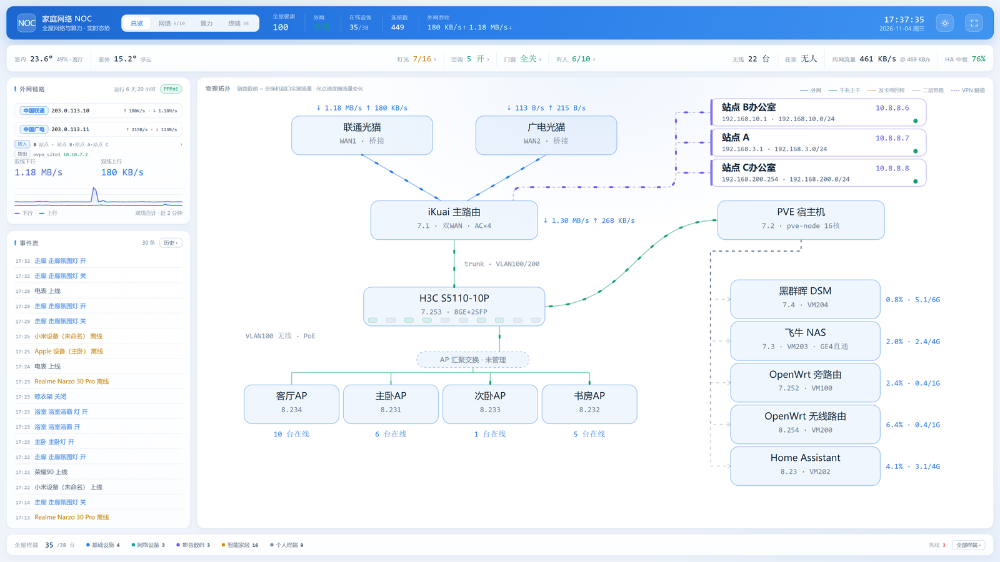
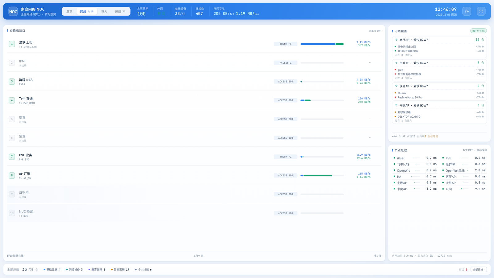
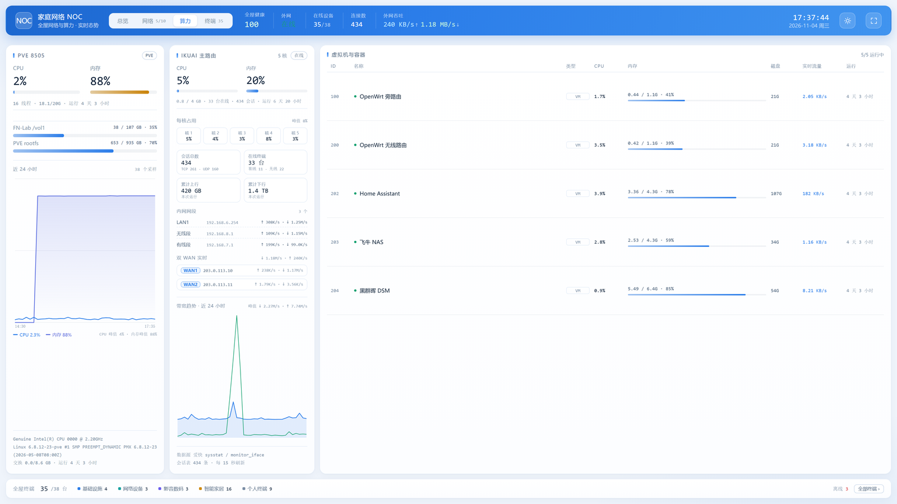
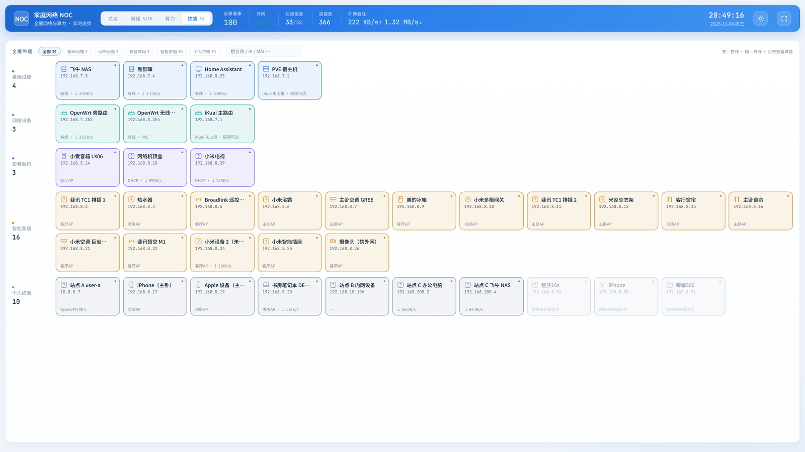
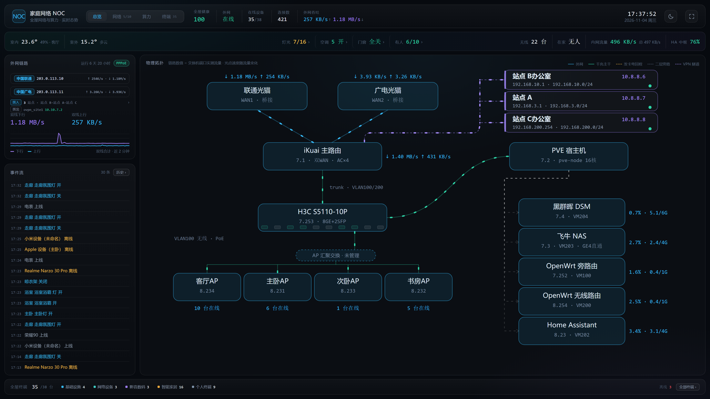

# Homelab 全屋网络监控面板

把自己家里的网络、虚拟化、存储、无线、智能家居全部塞进一块屏：**一眼看出哪里不对**，而不是逐台设备翻卡片。

整套东西跑在一台小型 fnOS / Linux 主机上，纯 Python 标准库 + 原生 JS，**零第三方运行时依赖**，容器镜像约 60MB。

> **当前版本 v2.2.1** · [查看更新日志](CHANGELOG.md)。本次修复终端在线判定抖动：在线设备不再被误标灰色、也不再反复播报上下线。

---

## 界面预览

> 以下截图取自实际运行环境，出于隐私考虑，公网 IP、MAC 地址、Wi-Fi 名称、站点与账号名已替换为示例值（`203.0.113.x` / `02:00:00:00:00:xx`），其余数据未改动。

**总览** —— 左边外网双线 + 事件流，中间物理拓扑（链路流光速度 = 端口实测流量），右上是三个 VPN 拨入站点。



**网络** —— 交换机一行一口：链路类型、实时收发、PoE 功率；右侧每台 AP 的 SSID、信道、客户端信号，下方 12 个节点的 RTT 探测。



**算力** —— 四栏通栏：PVE 宿主机（含虚拟机与容器表）、iKuai 主路由、远程爱快、远程飞牛 NAS。两台路由器版式与高度完全对齐（每核占用、会话统计、网段与隧道、线路状态、24h 带宽趋势），卡片标题随站点配置，不写死在代码里。远程设备分别经 VPN SSH / API 采集，隧道断时降级显示「离线」。



**终端** —— 按类别横铺的终端墙，一格一张卡：名称 + 完整 IP + 接入方式 + 实时速率，顶部可按名称/IP/MAC 过滤。



**备份** —— 二级页面：经反向代理把远程站点的群晖备份监控整页嵌进来，不用切 VPN，iframe 内的 API 请求也一并走代理。

**安防** —— 摄像头快照网格 + 点击放大实时画面。浏览器播不了 RTSP，统一由本机 go2rtc 转封装：网格每 2 秒拉一张 640px 缩略 JPEG（H265 也只需解一帧，很省 CPU），放大的实时流对 H265 自动转 H264 后以 fMP4 输出。RTSP 源写在 `config.local.json` 的 `cameras` 段，地址不下发到前端；离开页面即断开所有流，转码不会在后台空跑。某项改成 `{"id":"cam05","blank":true}` 即保留一个空槽位（不拉流、不计入路数），以后填回 `rtsp` 就能补上新摄像头。

**深色主题** —— 同一套布局，颜色令牌级切换，选择记在 localStorage，首屏不闪白。



---

## 目录结构

```
.
├── noc/                        「全屋状态大屏」（主项目）
│   ├── app/
│   │   ├── server.py           HTTP 服务 + SSE + 采集调度 + 历史查询 + /bkp /cam 反向代理
│   │   ├── state.py            快照聚合 / 事件流 / 健康分 / 指标采样
│   │   ├── store.py            SQLite 持久化（事件 + 指标，默认留 90 天）
│   │   ├── config.py           配置加载（环境变量 + config.local.json）
│   │   ├── assets.py           静态资产表（从本地配置读取）
│   │   ├── collectors/         十一路采集器
│   │   │   ├── ikuai.py        爱快路由 API
│   │   │   ├── pve.py          Proxmox VE API
│   │   │   ├── switch.py       TP-Link 系网页管理的 PoE 交换机
│   │   │   ├── miwifi.py       小米路由器（AP 模式）
│   │   │   ├── ha.py           Home Assistant 实体（环境 / 灯光 / 空调）
│   │   │   ├── localnet.py     本机内核读数（/proc）
│   │   │   ├── pinger.py       TCP RTT 探测
│   │   │   ├── fnos.py         远程 fnOS（SSH）
│   │   │   ├── remote_ikuai.py 远程 iKuai（VPN API）
│   │   │   ├── lanping.py      终端全量 ICMP 探活
│   │   │   └── cameras.py      摄像头流注册（go2rtc）
│   │   └── static/             单页前端（index.html / style.css / app.js）
│   ├── agent/
│   │   ├── nas_net_agent.py    NAS 侧采集端（补二层流量盲区）
│   │   └── compose-create.example.json
│   ├── data/                   运行数据（SQLite、HA 令牌落盘，已 gitignore）
│   ├── config.example.json     站点配置模板（复制为 config.local.json）
│   ├── .env.example            凭据模板
│   ├── Dockerfile
│   ├── docker-compose.yml
│   └── README.md               子系统详细文档（采集协议的坑都记在这里）
├── monitor/                    旧版「设备温度/负载看板」（仍在用）
│   ├── app/                    服务端 + 静态页
│   ├── agent/                  采集端 + 一键安装脚本
│   └── .env.example
├── scripts/                    运维脚本（部署、探测、WireGuard、fnOS 调优）
│   └── _common.py              统一从 .env 读连接参数
├── tests/                      单元测试 + 前端渲染桩测试
├── docs/
│   └── screens/                README 用的界面截图（已脱敏）
├── .env.example                运维脚本的凭据模板
├── CHANGELOG.md                版本更新日志（每个 git tag 对应一条）
├── VERSION                     当前版本号，/api/health 与顶栏读它
├── .gitignore
└── README.md
```

---

## 功能列表

### 新版大屏（`noc/`）

| 模块 | 内容 |
|---|---|
| **六页签分层** | 总览 / 网络 / 算力 / 备份 / 终端 / 安防，一屏只放一类信息，底部统计条常驻；支持直链 `#network` `#security` 与键盘 `1`–`6` |
| **健康分** | 0–100 综合评分，异常项可点开看清单；红/琥珀/绿三档 |
| **物理拓扑** | 光猫 → 主路由 → 交换机 → AP / PVE / NAS，**链路流光速度 = 该端口实测流量** |
| **拨入站点** | VPN 拨入的三个站点直接画在主拓扑上，点开是「一站一拓扑」：隧道 IP、拨号路由器、站点内网网段与网段里的设备 |
| **端口级流量** | 交换机每个口的 link 速率、实时收发、PoE 功率；本机降噪后不会误报断链 |
| **无线覆盖** | 每台 AP 的 SSID、**真实信道**、在线数、客户端 MAC 归属到哪个 AP，每台只展开 2 台终端避免刷屏 |
| **终端墙** | 一格一张卡：名称 + 完整 IP + 接入方式（AP 名 / PPP 拨入 / 有线）+ 实时速率；点击看 MAC / 厂商 / 累计流量 |
| **算力（PVE）** | 宿主机 CPU/内存/rootfs、每台 VM/LXC 明细与网络差分、CPU 与内存趋势 |
| **算力（飞牛）** | 经 VPN SSH 采集远程 fnOS：CPU/内存/磁盘卷/温度/负载/运行时长，VPN 断时降级显示「离线」 |
| **算力（远程爱快）** | 经 VPN API 采集远程 iKuai：CPU/内存/每核占用/会话统计/网段与隧道实时收发/线路状态/24h 带宽趋势，版式同 iKuai 主路由，兼容 V3/V4 |
| **算力（iKuai）** | 主路由 CPU/内存、每核占用、会话数、在线终端、内网网段实时收发、双 WAN 线路状态与速率 |
| **环境与智能家居** | 室内按**房间点名实体**（温度/湿度/PM2.5/甲醛/PM10，按国标上色）、室外天气（含三级兜底）、灯光按房间分组、窗帘、人体存在、空调 |
| **事件流** | 上下线、链路翻转、灯光开关，都带时间去抖与重复抑制，**落库后可回溯** |
| **历史回溯** | 事件与指标存 SQLite，支持 24h / 7d / 30d，按级别、关键字筛选，画带宽与负载趋势 |
| **二层流量** | NAS 侧采集端上报的网卡总吞吐，扣掉网关侧外网流量 = 内网直连流量 |
| **备份页** | 反向代理把远程站点的备份监控页整页嵌入，GET / POST 与页内 API 请求都走代理，上游不可达时给提示页 |
| **安防页** | 摄像头快照网格 + 点击放大实时画面；H265 自动转 H264，网格支持空槽位；RTSP 地址不下发前端 |
| **终端全量探活** | ICMP 与 AP 客户端表兜底网关漏报，灰色卡不再残留过期流量；宽限期内自动复判 |
| **明暗主题** | 蓝白为主视觉，深色主题保留；跟随系统 / 手动切换，选择记在 localStorage，首屏不闪白 |

### 旧版看板（`monitor/`）

温度、CPU、负载、磁盘的轻量汇总，带**来源分流**（内网可看面板，公网只允许上报）与 SQLite 历史留存。

---

## 快速开始

### 环境要求

- Linux（推荐 fnOS / Debian 系）或任何能跑 Docker 的机器
- Docker + Docker Compose
- Python 3.9+（只有跑 `scripts/` 时才需要，容器内自带）
- 想跑脚本的话：`pip install paramiko`

### 1. 取代码

```bash
git clone <你的仓库地址> homelab-noc
cd homelab-noc
```

### 2. 配置：三步复制

仓库里**没有任何真实地址与密码**，全部靠下面三个模板生成：

```bash
# ① 看板主配置（凭据）
cp noc/.env.example noc/.env

# ② 站点布局（设备清单、端口接线、拓扑文字）—— 这一步最容易被忘
cp noc/config.example.json noc/config.local.json

# ③ 运维脚本用（只在跑 scripts/ 时需要）
cp .env.example .env
```

然后编辑这两个文件：

**`noc/.env`** —— 只管"连什么、用什么账号"：

```ini
IKUAI_URL=https://192.168.X.1
IKUAI_USER=admin
IKUAI_PASS=你的路由器密码

PVE_URL=https://192.168.X.10:8006
PVE_USER=root@pam
PVE_PASS=你的PVE密码

SWITCH_URL=http://192.168.X.3
SWITCH_USER=admin
SWITCH_PASS=你的交换机密码

MIWIFI_USER=admin
MIWIFI_PASS=你的AP密码

HA_URL=http://192.168.X.20:8123
# 推荐：长期访问令牌（HA 网页 → 头像 → 安全 → 长期访问令牌）
HA_TOKEN=你的HA长期令牌
# 不用令牌时才填账号密码
HA_USER=你的HA账号
HA_PASS=你的HA密码

NAS_REPORT_TOKEN=随便生成一串十六进制
NAS_IP=192.168.X.30
```

> 令牌生成：`python -c "import secrets;print(secrets.token_hex(16))"`

**`noc/config.local.json`** —— 只管"家里长什么样"：

- `devices`：IP → 名称 / 房间 / 图标 / 分类
- `switch.ports`：交换机每个口接的是谁
- `wifi.hosts`：每台 AP 的地址
- `probes`：要测延迟的节点
- `topology`：拓扑节点上显示的文字（可以写自己的 IP 末位）
- `ha.env_rooms`：**室内环境按房间点名实体**，一个房间一段
  ```json
  { "name": "客厅", "src": "ZM1 · MQTT",
    "entities": { "temp": "sensor.xxx_temperature", "hum": "sensor.xxx_humidity",
                  "pm25": "sensor.xxx_pm25", "hcho": "sensor.xxx_hcho" } }
  ```
  为什么必须点名：HA 里叫「温度」的实体有几十个，群晖每块盘、冰箱、浴霸、空调自检都会冒充室温，
  一旦按 `device_class` 自动挑，顶栏就会显示 68°C 这种数字。
- `ha.outdoor_entity` / `ha.outdoor_fallback`：室外天气实体（如 `weather.forecast_home`）与它整块
  `unavailable` 时的备用温度源，按顺序取第一个有数的
- `ha.lamp_switch_prefix`：灯控面板的 switch 实体前缀。不配就只按实体名 `_on_p_x_y` 规则匹配，
  会把「机柜插座」「空调喜好模式」也算成灯，建议按自己的面板填
- `vpn.clients`：拨入站点名录，键是隧道地址，写 `name/short/user/router/lan/gw/dev` 后才有「一站一拓扑」
- `wan`：双 WAN 的运营商名称与线路标签（`acct` 宽带账号可留空）

**任何一项没配都不会崩**：缺 `config.local.json` 时终端墙为空、拓扑用通用标签；缺 `.env` 里某个地址时对应采集器会显示"未配置"而不是去连一个瞎猜的地址。

### 3. 启动

```bash
cd noc
mkdir -p data
docker compose up -d --build
```

构建时如果镜像源报 401，用传统构建器绕开：

```bash
DOCKER_BUILDKIT=0 docker compose build
```

### 4. 验证

```bash
# 服务活着吗
curl -s http://127.0.0.1:8940/api/health

# 看各采集器有没有报错
curl -s http://127.0.0.1:8940/api/snapshot | python3 -c "import json,sys; print(json.load(sys.stdin).get('errors'))"
```

浏览器打开 `http://<主机IP>:8940` 即可。

### 5. 更新（改完代码之后）

```bash
# 前端（app/static 是只读挂载，改完刷新浏览器就生效）
# 后端（Python）
docker compose restart
```

或者用仓库自带的增量部署脚本（推代码 + 传配置 + 重建容器一条龙）：

```bash
python scripts/deploy_noc.py
```

---

## 数据持久化与历史回溯

事件与指标都落在 SQLite（容器内 `/data/noc.db`，对应宿主 `noc/data/`，WAL 模式，默认保留 90 天）。
不想要历史了直接删掉 `data/noc.db`，下次启动会重建空表，只是曲线要从头攒。

| 接口 | 用途 |
|---|---|
| `GET /api/events` | 最近事件（内存环形缓冲，最快） |
| `GET /api/events/history?hours=24&level=warn&q=关键词` | 按时间窗 / 级别 / 关键字查历史事件 |
| `GET /api/events/days` | 哪些天有数据，用于时间轴 |
| `GET /api/metrics?hours=24&step=900` | 指标采样（在线数 / CPU / 内存 / 上下行），按 step 降采样后画趋势 |
| `GET /api/store` | 库的体积、行数、保留天数 |

界面里事件流右上角的「历史 ›」和底部的时间范围就是查这些接口；PVE 与 iKuai 卡片里的趋势图
也复用 `/api/metrics`，不额外打请求。

---

## 运维脚本

所有脚本的连接参数都从根目录 `.env` 读，缺项会直接告诉你缺哪个变量，不会静默失败。

| 脚本 | 作用 |
|---|---|
| `scripts/deploy_noc.py` | 增量部署新版大屏到中心节点 |
| `scripts/add_device.py` | 在旧看板登记新设备并打印安装命令 |
| `scripts/pve_probe.py` | 勘察 PVE 宿主机环境 |
| `scripts/pve_install.py` | 把采集端装到 PVE 宿主机 |
| `scripts/fnos_lid_disable.py` | fnOS 合盖不休眠 |
| `scripts/fnos_check_failed.py` | 查 fnOS 开机 failed 的服务 |
| `scripts/wg_setup.py` | 重建 WireGuard 服务端 |
| `scripts/wg_add_pc.py` | 给新客户端加一个 peer |

> WireGuard 的私钥、二维码、`*.conf` 全部在 `wireguard/` 下，**已整体 gitignore**，永远不要提交。

---

## 测试

不需要 pytest，也不需要真实设备——测试用合成数据：

```bash
python tests/test_devices.py    # 终端上下线降噪（9 组场景）
python tests/test_debounce.py   # 链路事件去抖
python tests/test_settle.py     # 交换机读数抖动复核

# 前端渲染：给一份快照 JSON，用 DOM 桩跑 app.js
node tests/render_test.js <快照.json> noc/app/static/app.js
```

`test_devices.py` 会自己注入合成资产表，地址前缀取自 `config.LAN_PREFIX`，**换任何内网段都能跑**。

---

## 安全设计

这个仓库按"公开可发布"的标准整理，规则如下：

| 类别 | 处理方式 |
|---|---|
| 密码 / 令牌 | 只存在于 `.env`（gitignore），仓库里只有 `.env.example` 模板；代码里凭据的默认值一律为空串 |
| 内网地址 / 设备清单 / 运营商账号 | 只存在于 `config.local.json`（gitignore），模板里是 `192.168.X.X` / `YOUR_ISP_ACCOUNT_HERE` |
| HA 实体与设备编号 | `ha.env_rooms`、`ha.lamp_switch_prefix` 走本地配置，代码里不写实体 ID（否则设备编号会随代码公开） |
| WireGuard 私钥 | 整个 `wireguard/` 目录 gitignore |
| 运行数据 | `data/`、`*.db`、`*.log`、`shots/` gitignore |
| 编辑器备份与历史重写残留 | `*.bak`、`*.orig`、`*.rej`、`.git-rewrite/` gitignore |
| 前端 | 拓扑文字由后端下发（`site.topology`），代码里没有 IP |

提交前建议自查一遍：

```bash
git status --short          # 有没有意外的新文件
git diff --cached --stat    # 暂存区都改了什么
git diff --cached | grep -nE "192\.168\.[0-9]+\.|10\.[0-9]+\.[0-9]+\.|(password|passwd|token|secret)\s*[:=]\s*['\"][^'\"]{6,}"
```

这条 `grep` 命中即停手：真实地址与凭据只该出现在被忽略的文件里。

---

## 后续更新流程

1. 改代码 → 本地跑 `tests/` 三个 Python 套件，确保没回归
2. 前端改完刷新浏览器即可；后端改动 `docker compose restart`
3. `git add -p` 逐块看改动，**确认没有 `.env`、没有真实 IP** 再 `git commit`
4. 推之前 `git status --short` + 上面那条 `grep` 复核一次

分支习惯：日常改动开 `feat/xxx`、`fix/xxx` 分支，跑通再合进 `main`，出问题可以直接丢掉整条分支。

提交信息用 `类型: 做了什么`（Conventional Commits），正文写清楚**为什么改**：

```
feat(ui): 四页签分层 + 蓝白皮肤 + 算力页并入 iKuai + 终端卡片显示详情
fix(collectors): 室内温度被群晖磁盘温度抢占，改为按房间点名实体
docs(config): 示例配置补 ha / vpn / wan 段，忽略就地备份文件
chore: 忽略极空间整理的一次性临时脚本
```

> 提交前确认作者身份：`git config user.name` / `user.email`。公开仓库的提交作者会永久留在历史里，
> 建议用 `用户名@users.noreply.github.com` 而不是真实邮箱。

---

## 已知边界

- **单网段大二层下，网关看不到同网段互访流量**。所以服务器/NAS 会被网关周期性"踢出"在线表，本项目靠 TCP 探测交叉验证 + 时间去抖来消除误报；不是设备真掉线。
- **同一 AP 下的设备互访**走 AP 内部直转，交换机和网关都统计不到，只能靠 NAS 侧采集端补。
- 部分厂商设备的网页接口字段不稳定（比如某型号交换机的 `spd_act` 约 1/6 概率读 0），采集器已做交叉校验，细节见 `noc/README.md`。

---

## 许可

个人自用项目，欢迎阅读、借鉴与二次改造；**转载或公开引用时请注明出处**（保留本项目链接即可）。代码按现状提供，不作任何担保。

---

## 鸣谢

感谢 [CY0618666/homelab-noc](https://github.com/CY0618666/homelab-noc) 的作者：项目在页面分层、终端接入判定与历史数据落库等方面的设计，借鉴了该仓库公开分享的思路与整体构思，在此致谢。
